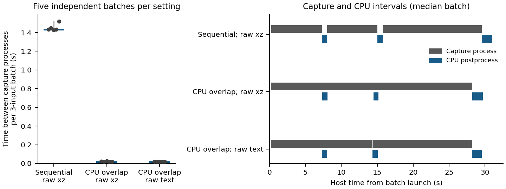

# GPU trace capture and CPU postprocessing

The launcher now admits the next GPU capture while completed bundles are grouped and compressed by CPU workers. This removes the dependency on the previous input's postprocessing. The live NVBit receiver still formats raw instruction records while the kernel executes.

The branch is based on Accel-Sim v2.0.0 (`64653015f85fb5664c84a10f48527e8897d289d0`). The tested cycle-model binary uses GPGPU-Sim `91880c53383d5a6a6742bfb1be2c5f34e39c7871`. No cycle-model, trace-formatter or device-instrumentation source is changed by this branch.

## Where the separation occurs

| Existing owner | Work | Placement |
|---|---|---|
| `instrument_inst()` in `inject_funcs.cu` | Collect dynamic warp records and push them to the NVBit channel | Live GPU execution |
| `recv_thread_fun()` in `tracer_tool.cu` | Drain the channel, format raw records and optionally compress raw files | Live capture process; retained here |
| `run_hw_trace.py` and `TracePipeline` | Admit one capture at a time and submit closed bundles to CPU workers | Host caller plus CPU workers |
| `group_per_block()` in `post-traces-processing.cpp` | Group completed records by CTA/warp and compress replay output | CPU worker; overlaps later captures |
| Accel-Sim cycle model | Consume a completed replay bundle | CPU simulation; independent of GPU capture |

Kernel exit synchronizes the device, flushes the channel, waits for the receiver and closes the raw file. CPU work is submitted after the capture process exits. Worker counts and pending-bundle counts are bounded. The CPU phase has no visible CUDA devices and no CUDA injection/preload variables. Reused directories wait for their prior worker before scripts or traces are overwritten. Failed phase receipts are retained and produce a nonzero launcher exit. The serial default and generated `run.sh` remain available.

The existing `TRACE_FILE_COMPRESS=0` option writes raw text without live xz compression. Combined with `.tracez` output, final replay compression occurs in the CPU worker. It does not defer raw text formatting or channel draining.

## Repeated hardware measurements

One RTX A6000 on gluck; 32 host logical CPUs available to the task. Each batch captures FADD, IMAD and SHFL. Each application uses one CTA, one warp and 2,048 rounds with the existing clock-free fixture, three full-work warmups and one measured-work launch. These are **host collection throughput measurements**, not measurements of instruction latency or GPU timing accuracy. Each condition has five independently launched batches. Condition order rotates between repetitions. Existing CPU simulations and the independent GPU1 collector remained active, so the ranges describe this shared-host execution.

Each cell is median [minimum, maximum] over the five batches. The gap is the sum of the two intervals between successive capture processes, not a hardware SM utilization counter.

| Setting | Total elapsed per 3-input batch (s) | Time between capture processes per batch (s) |
|---|---:|---:|
| Sequential; raw xz | 31.023 [30.981, 31.101] | 1.435 [1.428, 1.521] |
| CPU overlap; raw xz | 29.689 [29.619, 29.724] | 0.018 [0.017, 0.025] |
| CPU overlap; raw text | 29.598 [29.492, 29.710] | 0.018 [0.017, 0.019] |

Overlapping CPU work reduces median total elapsed time from **31.023 s to 29.689 s (4.30%)**. Median time between capture processes drops from **1.435 s to 0.018 s**. The remaining live capture duration is approximately 28 s per batch. This result supports eliminating postprocessing waits before the next capture; it does not support claiming that all tracing cost has moved off the GPU path.

Disabling raw xz compression gives 29.598 s median elapsed time. Its range overlaps the compressed-capture overlap setting, so these measurements establish no consistent additional elapsed-time benefit from disabling raw compression. Median raw storage rises from **34,576 bytes to 74,821,848 bytes** per batch. Raw compression remains the default.

All five observations are plotted. The timeline shows the batch nearest each setting's median elapsed time. Dark gray denotes the entire capture process, including its receiver and startup/teardown; blue denotes CPU postprocessing. These intervals are not GPU active-cycle measurements. [Complete batch values](data/trace-cpu-gpu-pipeline/batch-times.csv) and [plot/reduction data](data/trace-cpu-gpu-pipeline/summary.json) are retained.

## Trace preservation and cycle-model regression

- Eight process-level tests pass, including actual child-process overlap, queue-depth backpressure, CPU environment isolation, repeated-directory reuse and failure propagation.
- All 45 real GPU captures succeed. All 180 launch outputs equal their CPU-generated golden outputs.
- An independent reader decompresses every `.tracez` subchunk and compares its full instruction strings to the corresponding raw trace. All **17,577,240 instruction records across 180 kernels** match, including PCs, masks, registers, immediates and addresses. Per-kernel counts remain identical across all three settings: FADD 71,711; IMAD 71,709; SHFL 149,534. This check covers the stated one-CTA/one-warp fixtures; it is not a general trace-format proof.
- A retained compiler-control trace (`precise-imad-r128-4ee23b9f`) is reprocessed from identical raw files. All four grouped text files match the original bytes after decompression. Eight text replay runs and four `.tracez` replay runs reproduce the exact cumulative cycle sequence **62,975; 122,826; 182,677; 242,528**. The fourth-kernel increment is 59,851 cycles. This checks preservation of an unchanged cycle-model input; it is not real-GPU timing validation.

[Trace verification summary](data/trace-cpu-gpu-pipeline/trace-preservation.json), [text replay receipts](data/trace-cpu-gpu-pipeline/REPLAY-EQUIVALENCE.json), [tracez replay receipts](data/trace-cpu-gpu-pipeline/TRACEZ-EQUIVALENCE.json), [input hashes](data/trace-cpu-gpu-pipeline/input-sha256.json) and [hardware metadata](data/trace-cpu-gpu-pipeline/hardware.json) record the exact inputs and checked scope.

## Remaining live serialization

A complete deferred formatter has not been implemented. The receiver currently needs the live opcode-ID mapping and the trace records. A future saved-record contract must preserve all fields consumed by formatting, including optional lane values and TMA metadata. Dumping the existing struct verbatim would be expensive: its measured host ABI size is **1,296 bytes**, including **896 bytes of lane-value arrays**. For the inspected long synchronization capture's 75,498,384 records, an unmodified struct dump would occupy 97,845,905,664 bytes before any metadata or compression. This is a measured layout and a storage calculation, not a benchmark of a proposed serializer. [Layout measurement](data/trace-cpu-gpu-pipeline/RECORD-LAYOUT.json).

## Reproduction and storage

[Commands and scripts](../experiments/trace-cpu-gpu-pipeline/README.md) reproduce the workflow and figures. The host lacks zstd development headers; the postprocessor and independent verifier were built in the pinned CUDA 12.9 dependency image. The unsuccessful host build is retained with the successful container build.

The new run's logs, complete verification and input capsule are at:

`/mnt/hdd0/work/ncu/gpu-uarchsim/workspaces/gluck/research-trace-cpu-gpu-pipeline-accel-sim-trace-cpu-gpu-9e9ad7994355/experiments/trace-cpu-gpu-validation-20261023T051554Z`

Raw and replay traces are at:

`/mnt/hdd0/work/traces/gpu-uarchsim/gluck/research-trace-cpu-gpu-pipeline-accel-sim-trace-cpu-gpu-9e9ad7994355/trace-cpu-gpu-validation-20261023T051554Z`

The previously running GPU0 trace was allowed to finish before validation. Only its caller was held; the caller was resumed automatically after the 15 batches. Its one host-command receipt includes that operational hold, so it is excluded from these throughput measurements. Existing hardware counters, source binaries and model cycle values are not replaced by this validation population.
