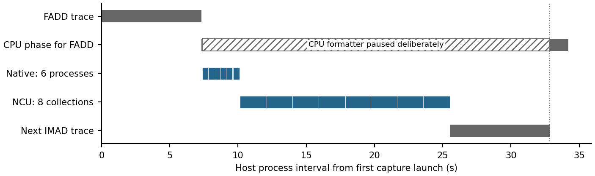
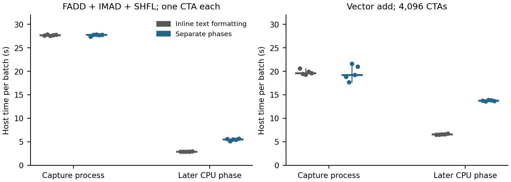

# Independent GPU trace capture and CPU trace processing

The GPU command saves instruction records and returns without starting or joining a CPU formatter, compressor or postprocessor. The separate CPU command reads that collection and creates replay traces. With the CPU formatter deliberately paused for **25.449 s**, six native processes, eight actual NCU collections and the next GPU trace completed before it resumed. This directly tests the dependency the phase split removes.

Checked source: `research/trace-cpu-gpu-pipeline` in `/home/inje/workspace/gpu/gpu-uarchsim/worktree/accel-sim-trace-cpu-gpu`, based on Accel-Sim v2.0.0 `64653015f85fb5664c84a10f48527e8897d289d0`. The retained cycle model uses GPGPU-Sim `91880c53383d5a6a6742bfb1be2c5f34e39c7871`. Device instrumentation, instruction selection, the existing postprocessor and the cycle model are unchanged. The text writer is moved into a separately callable CPU formatter.

## Source path and phase ownership

The original receiver formatted every instruction before draining the next NVBit channel buffer. The channel holds 1 MiB. Device flush waits for the host to copy that buffer and clear its doorbell. Kernel completion waits for the receiver and closes its raw xz stream. Moving only grouping/compression into a background worker leaves that live formatting dependency intact; a bounded worker queue and a final join also hold the caller.

```text
GPU phase
  instrument_inst -> ChannelDev::push / flush
                            |
                    ChannelHost::recv  (copies buffer, releases doorbell)
                            |
                 recv_thread_fun -> bulk native record-file writes
                            |
                 kernel flush marker -> metadata footer -> file close
                            |
                capture process returns -> gpu-traces.json: collected

CPU phase: separately invoked; no completion edge back to GPU phase
  gpu-traces.json snapshot -> saved records / options / opcode mapping
                            |
                    TraceFormatter -> original text / optional xz
                            |
                 existing CTA/warp grouping -> tracez or traceg
                            |
                         cpu-traces.json
```

| Owner | Retained work and state | Phase |
|---|---|---|
| `instrument_inst()` | Original record fields, lane values, masks and addresses | Live GPU capture |
| `recv_thread_fun()` | Drain the existing channel; save record chunks; acquire context-bound TMA API results if present | Live capture process |
| Kernel callbacks | Original kernel header/options/inventory; record metadata/footer and file close | GPU phase |
| `TraceFormatter` | Original text/address formatting; original per-warp spinlock/replay state | CPU phase |
| `post-traces-processing` | Existing CTA/warp grouping and replay compression | CPU phase |
| `run_hw_trace.py` | Independent GPU/CPU manifests and command receipts | Explicitly selected phase |

The GPU command has no CPU worker admission limit or final CPU join. A failed CPU case does not alter the GPU manifest or remove its record files. CPU processing clears CUDA visibility, injection and preload, performs no application discovery and does not call `nvcc`. The standalone formatter's linkage contains no CUDA or NVBit library. Fresh per-case trace directories prevent a second results namespace from replacing an existing collection.

The record file preserves the entire native 1,296-byte `inst_trace_t`, including 896 bytes of lane-value arrays. The producer populates those arrays even when value output is disabled. Its byte order, size, alignment and union offset are recorded and checked by the reader. This format is an intermediate native ABI, not a portable replay format. Record contents are copied in bulk without live per-field packing or text serialization.

## Real CPU hold and following GPU work

On RTX A6000 `GPU-088c2fff-3078-7fc9-c630-87034d7184fd`, the test captures FADD, starts a separate CPU phase and pauses its actual formatter process. It verifies that process's PID, start identity and stopped state, then completes:

- Six native FADD processes, each with three warmups and seven measured-work launches: **60 numerical outputs match the CPU golden output**.
- Eight NCU processes, each with three warmups and one profiled launch: **32 numerical outputs match**, eight `.ncu-rep` files import successfully, and all contain `gpu__time_duration.sum`, `sm__cycles_elapsed.max` and `smsp__inst_issued.sum`.
- The next IMAD GPU capture, with no CPU completion dependency.

The same formatter remains stopped until all following GPU work has finished. It is then resumed; both CPU phases finish successfully. Each plotted interval is a whole host process, including startup/teardown, not a GPU active-cycle interval. The deliberate pause is excluded from throughput measurements.



[Complete events and process identities](data/trace-cpu-gpu-pipeline/two-phase/independence.json), [NCU import receipts](data/trace-cpu-gpu-pipeline/two-phase/ncu-import.json) and [imported metric values](data/trace-cpu-gpu-pipeline/two-phase/summary.json) retain the observation. NCU uses `--clock-control none --cache-control none`; these measurements establish that collection can run, not a controlled-clock instruction-performance result.

## Five repeated batches per workload and setting

Both settings use the same rebuilt tracer, same application binaries/inputs and four identical full-work launches per application, the first three warmups. Setting order alternates across five repetitions. “Inline text formatting” uses `TRACE_DEFER_FORMATTING=0`, with live text/xz and later grouping. “Separate phases” uses `TRACE_DEFER_FORMATTING=1`, with live native records and later text/xz/grouping. CPU processing runs after capture for these cost measurements.

FADD/IMAD/SHFL each use one CTA, one warp and 2,048 rounds. Vector addition processes 1,048,576 elements with **4,096 CTAs × 256 threads**. All **160 numerical launch outputs** in the 20 repeated batches match their CPU golden outputs. These are host trace collection/processing costs; instrumented capture time is never used as native kernel performance.

Values are median [minimum, maximum], seconds over five batches. Capture sums the application-process receipts; the last column adds each batch's capture and CPU intervals and excludes unrelated launcher discovery. It is a sequential cost comparison, not the elapsed time of overlapped phases.

| Workload | Setting | Capture (s) | CPU phase (s) | Sequential phase sum (s) |
|---|---|---:|---:|---:|
| FADD + IMAD + SHFL | Inline text formatting | 27.683 [27.559, 27.870] | 2.923 [2.880, 2.979] | 30.617 [30.438, 30.797] |
| FADD + IMAD + SHFL | Separate phases | 27.765 [27.382, 27.891] | 5.529 [5.138, 5.674] | 33.162 [32.903, 33.485] |
| Vector add | Inline text formatting | 19.640 [19.284, 20.588] | 6.593 [6.502, 6.780] | 26.421 [25.878, 27.133] |
| Vector add | Separate phases | 19.237 [17.666, 21.620] | 13.750 [13.588, 13.914] | 33.104 [31.254, 35.534] |



**These timings do not establish a general capture speedup.** Capture ranges overlap for both workloads. Writing and rereading complete records increases the sequential phase sum. The demonstrated benefit is that CPU formatting/processing completion cannot hold the next GPU job. The host remains shared with CPU models and an independent GPU1 collector; record verification overlaps part of the vector timings, so the ranges must not be interpreted as isolated hardware limits.

Intermediate record storage is **1,518,696,876 bytes per instruction batch** and **2,717,932,808 bytes per vector batch**, before any text or replay output. The existing long synchronization capture's 75,498,384 records would require **97,845,905,664 record bytes** before metadata. Required channel draining and raw-file I/O remain able to backpressure capture; this change does not remove finite channel or disk bandwidth limits.

[All 20 batch values](data/trace-cpu-gpu-pipeline/two-phase/all-batches.csv), [ranges and metric readings](data/trace-cpu-gpu-pipeline/two-phase/summary.json), [instruction receipts](data/trace-cpu-gpu-pipeline/two-phase/instruction-batches.json) and [vector receipts](data/trace-cpu-gpu-pipeline/two-phase/vector-batches.json) preserve the full populations, including the slower observations.

## Trace preservation and cycle-model regression

The independent reference writer is extracted from the original receiver body. It reads the same saved record objects; its instruction formatting does not call the new formatter. It rejects TMA in this A6000-only reference test. Every byte of its full text output is compared with the deferred formatter's decompressed text.

- **92 captured kernels, 17,205,364 instruction records:** complete original/deferred text matches. This includes 72 instruction/smoke/hold-test kernels and 20 multi-CTA vector kernels. Every CTA/warp instruction sequence in all 20 vector kernels is independently checked against the grouped `.tracez` output. The 68 applicable instruction kernels' `.tracez` sequences also match; four smoke kernels use grouped text.
- **48 formatting-control combinations:** 2,048 actual captured records are round-tripped without byte changes and formatted with 16 output-flag combinations × three existing spinlock modes. Every output matches the original writer. These are formatting/control checks, not hardware validation of spinlock execution or the BAR/SYNCS value-emission paths.
- **Eight independent A6000 cycle-model processes:** the same saved IMAD records are encoded as original-writer grouped text and deferred `.tracez`, four runs per format. All reproduce cumulative cycles **33,146; 63,782; 94,418; 125,054** and cumulative instruction counts **144,224; 288,448; 432,672; 576,896**. This regression-only input uses 128 rounds and four launches. It tests preservation of a cycle-model input, not its agreement with hardware.
- **Seven workflow tests:** independent phase execution, no CUDA discovery for CPU processing, GPU progress while CPU is held, failure separation and preservation of existing collections/trace directories.

[Instruction record comparisons](data/trace-cpu-gpu-pipeline/two-phase/record-verification.json), [all vector CTA/warp comparisons](data/trace-cpu-gpu-pipeline/two-phase/vector-record-verification.json), [formatting matrix](data/trace-cpu-gpu-pipeline/two-phase/formatting-matrix.json) and [cycle-model receipts](data/trace-cpu-gpu-pipeline/two-phase/model-equivalence.json) define the checked scope. [Build/source and binary-identity checks](data/trace-cpu-gpu-pipeline/two-phase/final-checks.json) and [workflow-test output](data/trace-cpu-gpu-pipeline/two-phase/final-workflow-tests.json) are reported separately from these behavioral results.

TMA parsing/address APIs require a live CUDA context, so capture retains their acquisition and saves the returned metadata/addresses for CPU formatting. A6000 does not provide the hardware target for that path: TMA remains **target-missing**. Existing CUDA graph attribution is neither repaired nor validated. Hardware runs use spinlock mode none and register-value output disabled; complete record bytes remain preserved. No claim of all-instruction or all-application trace validity is made from this fixture set.

## Reproduction, provenance and retained attempts

[Two-phase reproduction instructions](../experiments/trace-cpu-gpu-pipeline/README.md) include the exact drivers and build commands. The [complete source bodies and hashes](../plans/trace-cpu-gpu-pipeline/TWO-PHASE-IDENTITIES.json), [effective experiment metadata](data/trace-cpu-gpu-pipeline/two-phase/experiment.json), [SDK identities](data/trace-cpu-gpu-pipeline/two-phase/nvbit-sdk.json) and [publication amendment](data/trace-cpu-gpu-pipeline/two-phase/publication-amendment.json) distinguish executed and published source. The amendment only rejects an already-existing per-case trace directory; the producer, formatter, model and fresh-capture behavior are unchanged.

Logs, NCU reports, model output and immutable inputs:

`/mnt/hdd0/work/ncu/gpu-uarchsim/workspaces/gluck/research-trace-cpu-gpu-pipeline-accel-sim-trace-cpu-gpu-9e9ad7994355/experiments/pr1/two-phase-capture-20261023T082229Z`

Record/text/replay trace bytes:

`/mnt/hdd0/work/traces/gpu-uarchsim/gluck/research-trace-cpu-gpu-pipeline-accel-sim-trace-cpu-gpu-9e9ad7994355/two-phase-capture-20261023T082229Z`

The first hold attempt missed the formatter because the test inspected only the main thread's child list. The corrected test inspects children of every process thread. That first attempt completed CPU processing normally and supplies no independence evidence. Its script/logs and the record-verifier's initial syntax-error attempt remain in the run directory, excluded from the successful experiment population.

The earlier postprocessing-only implementation and its 4.30% result retain their [original source/report identity](https://github.com/KU-CSArch/accel-sim-framework/blob/3576fff9018057a6c5e3ccd990fba91c7ae2c497/docs/reports/trace-cpu-gpu-pipeline.md). Those measurements concern a different phase boundary and are not evidence for full deferred formatting. Their datasets and figures remain retained. Existing motivation figures and the paper are not changed by this tracer task.
